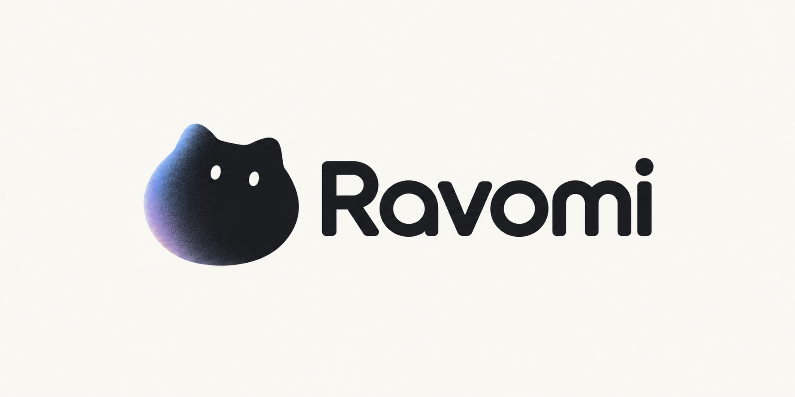
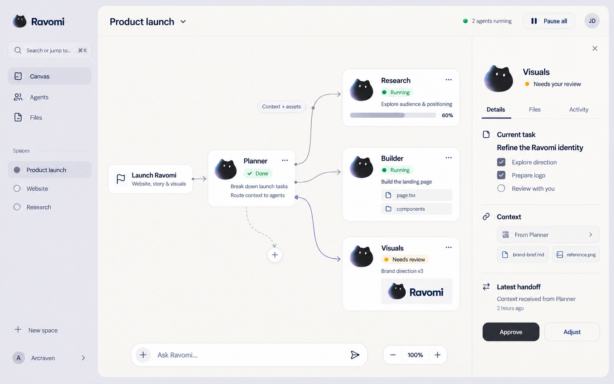

  

  <strong>A shared canvas for people and AI agents.</strong> 
  By Arcraven

  <strong>English</strong> | <a href="README-ZH.md">中文</a>

  <a href="https://github.com/Ravomi/ravomi-app">Explore the project</a>
  &nbsp;·&nbsp;
  <a href="https://github.com/Ravomi/ravomi-app/blob/main/PRD.md">Product direction</a>
  &nbsp;·&nbsp;
  <a href="https://github.com/Ravomi/ravomi-app/blob/main/DESIGN.md">Design principles</a>

Ravomi is being built around an infinite canvas where people can organize research, code, assets, and tasks alongside the agents working on them. Keep the whole project in view while independent branches move forward in parallel.

**Visible.** See each agent’s task, progress, dependencies, and results.

**Connected.** Turn a goal into a plan, connect reusable modules, and follow task and context handoffs between agents.

**Controllable.** Review results, revise a plan, pause work, and guide the next step without losing your place.

  
   
  Design concept · The intended experience, not a screenshot of the current application.

### Where the project stands

Ravomi is an early prototype. The repository currently centers on a local canvas editor; AI execution, workflow orchestration, and multi-agent handoffs are planned capabilities. Our product and design documents distinguish what works today from what is still being explored.

We are developing a workspace that stays clear as the work grows: quiet surfaces, legible connections, and a small graphite cat with a restrained blue-violet glow.

Follow the [repository](https://github.com/Ravomi/ravomi-app) for implementation progress, design decisions, and documented limitations.
